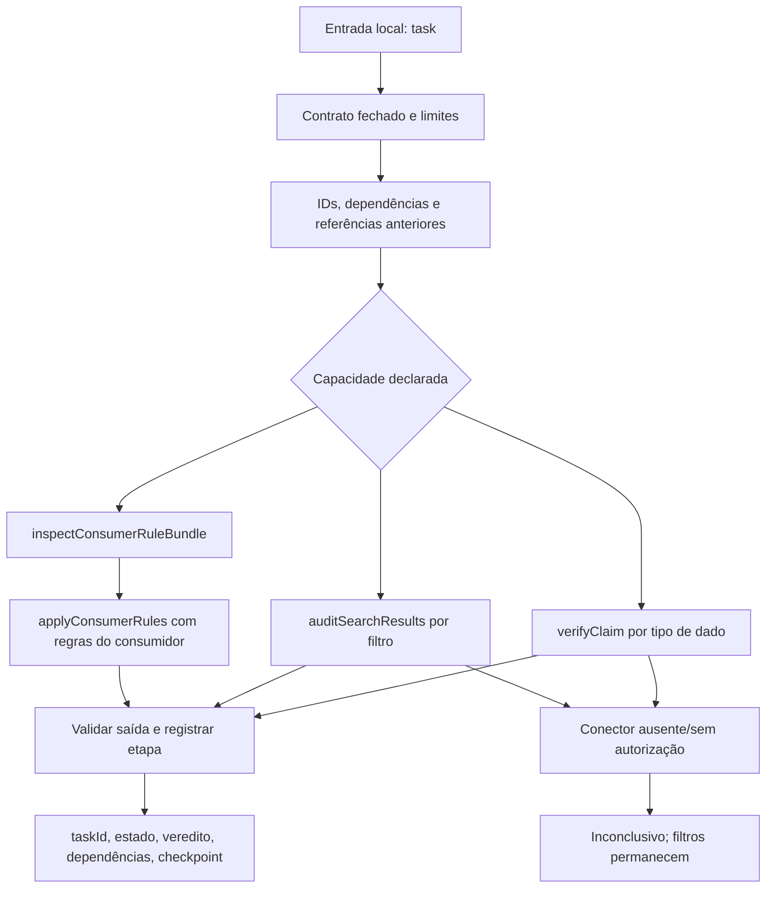

# Coordenação interna de validações

O runtime recebe tarefas pela mesma entrada JSON local já usada por `scripts/run_runtime.py`. Uma tarefa declara até oito etapas e escolhe capacidades do contrato v1. O coordenador valida o grafo, resolve apenas referências explícitas para resultados anteriores, chama as ferramentas determinísticas em sequência e valida cada saída contra o contrato da ferramenta.



## Responsabilidades e contrato

O consumidor escolhe cada ferramenta e fornece entradas, escopo, valores e regras declaradas. O runtime não inventa relações, precedência, conversões, fontes permitidas ou autorização. `verifyClaim` seleciona o plano conforme o tipo de dado; `auditSearchResults` mantém todos os filtros; inspeção e aplicação de regras do consumidor são etapas distintas. Uma referência `{"$resultFrom":"inspect"}` pode alimentar outra etapa somente se o produtor vier antes e estiver declarado em `dependsOn`. A referência passa a saída completa; não há interpolação ou ponteiro JSON arbitrário.

Cada resultado de etapa é validado pelo schema da ferramenta e devolvido com `id`, capacidade, estado, modo, tentativas e resultado/erro. `taskId`, estado geral, `verdict`, dependências ausentes, limites e checkpoint completam a resposta. `status=completed` significa que as chamadas locais terminaram; `verdict=inconclusive` significa que os fatos continuam sem evidência suficiente. Estrutura válida, regras aplicadas ou um plano de fonte não provam veracidade.

## Limites, falhas e retomada

- Até 8 etapas, 60 s de orçamento cooperativo, 2 tentativas, concorrência 1 e profundidade de delegação 0. Os limites podem ser reduzidos por requisição, nunca ampliados além dos tetos.
- As etapas executam sequencialmente. Somente uma falha declarada `retryable` pode ser repetida; as quatro ferramentas atuais são somente leitura/determinísticas e não acessam fontes externas.
- Identificadores repetidos, dependências adiantadas/cíclicas, referência sem dependência, schema inválido e resultado incompatível falham fechados. Falha em uma etapa bloqueia somente seus consumidores; etapas independentes ainda podem concluir, resultando em `partial`.
- Cancelamento é cooperativo entre ferramentas; `KeyboardInterrupt` é reportado como cancelado. O timeout é observado antes e depois de cada chamada síncrona, não interrompe código Python no meio da chamada. Ferramentas futuras com I/O precisarão implementar cancelamento próprio.
- Checkpoint leva resultados concluídos ao consumidor em memória e retoma apenas se digest da tarefa, etapa, capacidade e schema do resultado coincidirem. O runtime não grava tarefas, prompts ou resultados em disco; checkpoint recebido continua dado não confiável.
- Não existem workers isolados. Profis/capacidades são chamadas no mesmo processo; `subagents=0` e profundidade zero. Paralelismo entre etapas e acesso a ferramentas arbitrárias estão fora do escopo.

## Evidência e fonte

Sem conector de fonte independente, `verifyClaim` e auditoria do Busca retornam inconclusivo e registram a dependência ausente. Trechos e URLs do Busca não são reabertos por esta implementação. Nenhuma conta privada, registro de sistema, busca web, escrita, serviço pago ou fallback remoto é acessado. Os testes de injeção são marcados `simulated`; os testes sobre ferramentas chamam o runtime determinístico local e usam somente fixtures sintéticas públicas do contrato.

## Entrada normal e validação

Envie ao `scripts/run_runtime.py` um envelope `{"task": <contrato>}`. O envelope `{"tool": "...", "input": {...}}` existente continua compatível. Exemplo de tarefa direta:

```json
{
  "task": {
    "contractVersion": "1.0.0",
    "objective": "Verificar uma afirmação sobre um estudo",
    "stages": [
      {
        "id": "claim",
        "tool": "validation.verifyClaim",
        "input": {
          "contractVersion": "1.0.0",
          "claim": "Afirmação sintética para teste",
          "dataType": "study_result",
          "context": "Fixture pública sintética",
          "candidateReferences": [],
          "userFilters": []
        }
      }
    ]
  }
}
```

Para uma composição, declare primeiro `validation.inspectConsumerRuleBundle`, depois `validation.applyConsumerRules`, incluindo `"dependsOn": ["inspect"]` e `"bundleReceipt": {"$resultFrom": "inspect"}` na entrada da segunda etapa. As regras continuam declarações do consumidor, sem autoridade autenticada.

Verifique com `python -m unittest discover -s tests -v`, `python scripts/validate_contracts.py`, `python scripts/check_environment.py`, `python -m compileall -q agent_runtime tests` e `git diff --check`. Veja [política de evidência](EVIDENCE_POLICY.md), [arquitetura](ARCHITECTURE_PLAN.md), [requisitos](REQUIREMENTS.md), [especializações](SPECIALIZATIONS.md) e [contrato v1](../contracts/v1/README.md).
